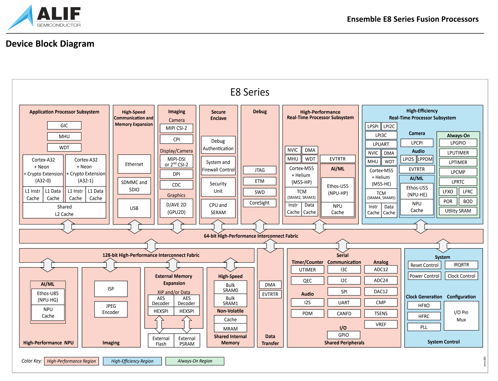
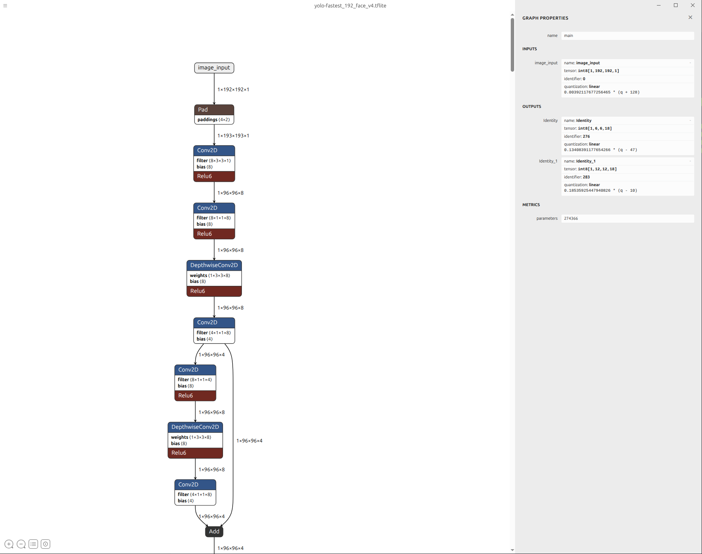
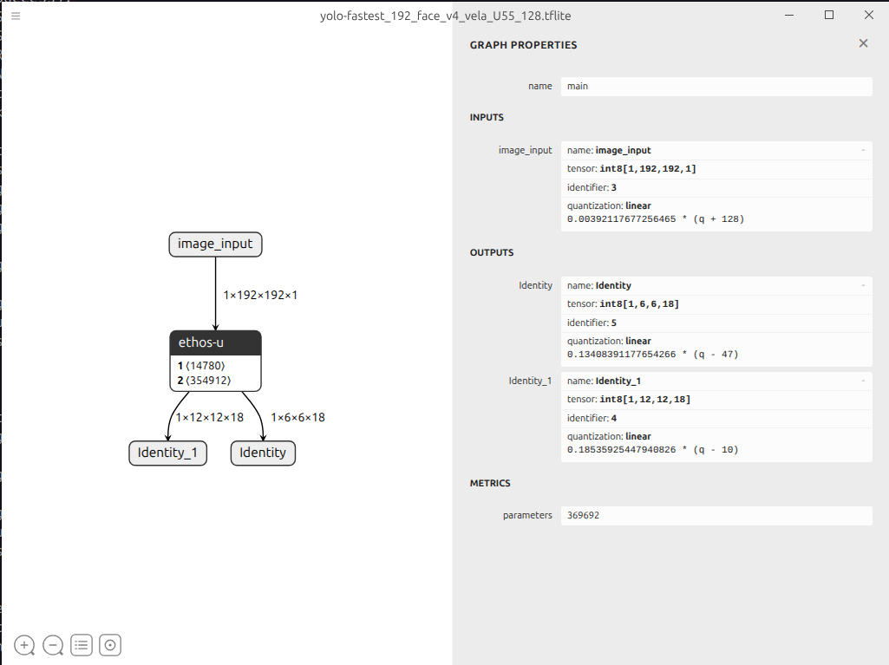
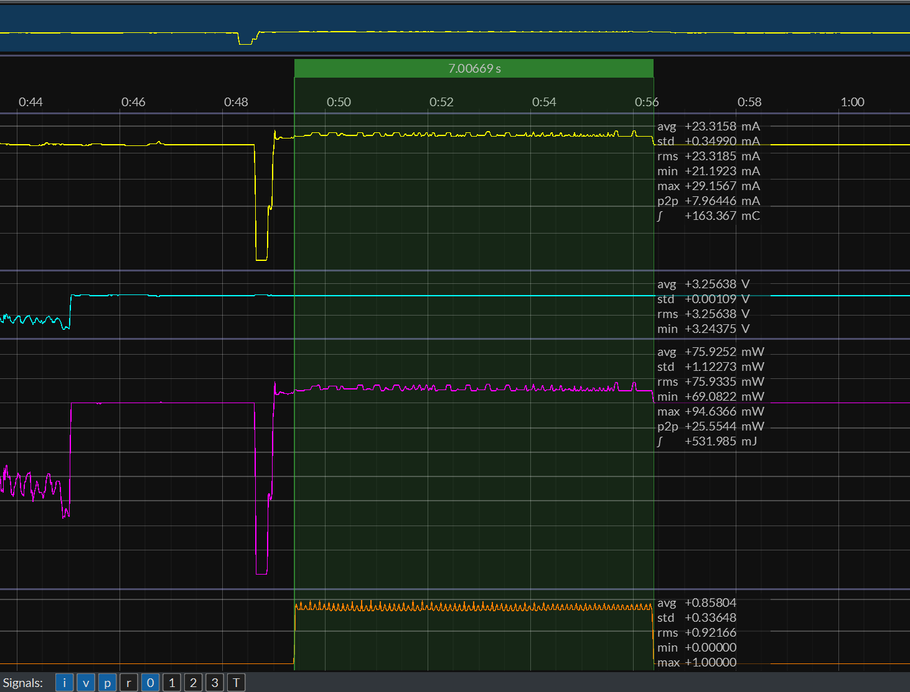
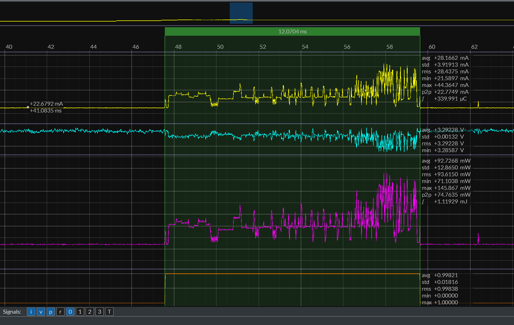
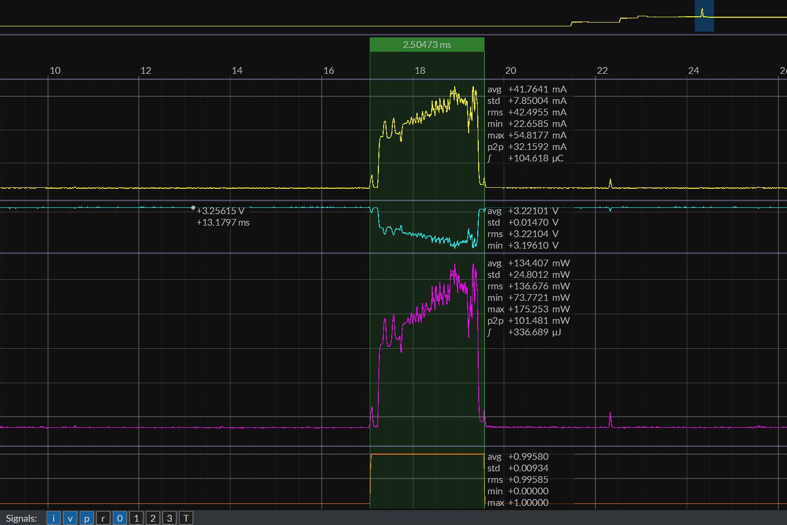
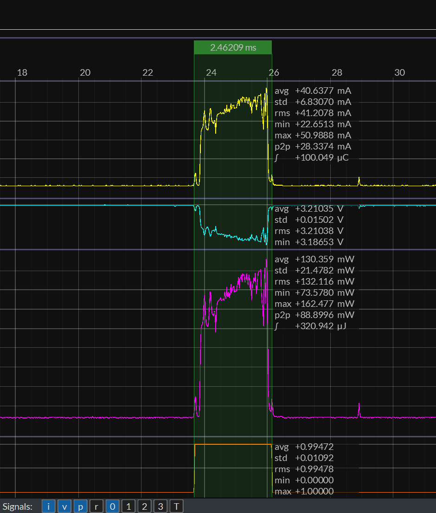

<!--
Slide source for the Alif Semiconductor ML hands-on training.
The PowerPoint is generated from this file:  python build_slides.py
Conventions: slides are separated by a line containing only ---, the first "# " line is the
slide title, "::: notes" ... ":::" is the speaker notes, and an optional HTML comment on the
first line of a slide, containing "layout: title|section|handson; time: ...", selects the style.
-->

<!-- layout: title -->
# Edge AI on Alif Ensemble

## Hands-on ML deployment with TensorFlow Lite Micro and Arm Ethos-U NPUs

Analog Devices Application Engineering training · 3 hours · AppKit-E8-AIML

::: notes
Welcome everyone. Today is mostly hands-on: you will take a face detection model from "runs on the CPU" to "runs on three different NPUs", measure it, and connect it to a live camera.
:::

---

# About me and the team

- **Aki Makkonen**
- Background: embedded software, ML deployment on MCUs

---

# What you will be able to do after today

- Explain the Ensemble E8 compute and memory options for ML: Cortex-M55 HE and HP, Ethos-U55-128, Ethos-U55-256 and Ethos-U85-256, plus TCM, SRAM, MRAM and OSPI memory
- Integrate the TFLM runtime and the Ethos-U driver into a CMSIS solution project
- Compile a model with Vela and read its performance and memory estimates
- Write the pre- and post-processing for an int8 quantized model
- Measure inference time, memory use, NPU counters and power, and compare them against Vela
- Choose a deployment configuration for a customer use case

---

# Agenda (3 hours)

| Time | Block | Format |
|---|---|---|
| 0:00 | Welcome, team, goals | Talk (10 min) |
| 0:10 | Ensemble E8 platform, NPUs, memories, ML frameworks | Talk (15 min) |
| 0:25 | **Phase 00** – environment check: build, flash, UART, debug | Hands-on (20 min) |
| 0:45 | **Phase 01** – TFLM integration, model graph, quantization, CPU inference | Talk + hands-on (20 min) |
| 1:05 | Break | 10 min |
| 1:15 | Vela compiler deep dive | Talk (15 min) |
| 1:30 | **Phase 02** – Ethos-U integration, four NPU deployments, PMU, power | Hands-on (25 min) |
| 1:55 | Break | 10 min |
| 2:05 | **Phase 03** – pre- and post-processing, faces in a still image | Hands-on (20 min) |
| 2:25 | **Phase 04** – ISP, AIPL, live camera and display | Hands-on (15 min) |
| 2:40 | Deployment options and external memory | Discussion (10 min) |
| 2:50 | Wrap-up, feedback, Q&A, optional demos | 10 min |

::: notes
About 100 of the 180 minutes are hands-on. Every phase folder is a complete, buildable project, so anyone who falls behind can jump to the next phase folder and continue.
:::

---

<!-- layout: section -->
# Background

## The platform, the NPUs and the software stack

---

# Ensemble E8 block diagram



::: notes
Walk the diagram from left to right: the A32 application subsystem, the shared peripherals and imaging blocks, then the HP and HE real-time subsystems, each with its own Ethos-U55. At the bottom: the Ethos-U85 on the 128-bit fabric, the bulk SRAM, MRAM and the OSPI external memory. The colours show the power regions: high-performance, high-efficiency and always-on.
:::

---

# Ensemble E8 at a glance

| Block | E8 configuration |
|---|---|
| Application cores | 2× Cortex-A32 (Linux or RTOS) |
| High-performance MCU (HP) | Cortex-M55 at 400 MHz, Helium (MVE) + **Ethos-U55-256** |
| High-efficiency MCU (HE) | Cortex-M55 at 160 MHz, Helium (MVE) + **Ethos-U55-128** |
| Shared NPU | **Ethos-U85-256**, reachable from any core |
| On-chip SRAM | 9.75 MB in total: 8 MB bulk SRAM0/SRAM1 plus the HP and HE TCMs |
| On-chip NVM | 5.5 MB MRAM (execute-in-place) |
| External memory | 2× Octal SPI (OSPI): flash or PSRAM, XIP capable |
| Vision and graphics | MIPI CSI-2, CPI, ISP, MIPI DSI, CDC200, D/AVE2D GPU, JPEG encoder |
| Security | Secure Enclave: boot, keys, power and clock services |

::: notes
Source: the Ensemble DFP pack device description for AE822FA0E5597BS0. The key message is that one chip offers three NPUs with very different performance and power, and several memories with very different bandwidth. Choosing the combination is the main deployment decision, and we will try four combinations today.
:::

---

# Three NPUs, one toolchain

| | Ethos-U55-128 | Ethos-U55-256 | Ethos-U85-256 |
|---|---|---|---|
| Attached to | M55 HE (local) | M55 HP (local) | Shared, any core |
| NPU clock in Vela config | 160 MHz | 400 MHz | 400 MHz |
| Peak int8 throughput | 41 GOPS | 205 GOPS | 205 GOPS |
| Operator coverage | CNN | CNN | CNN + transformer ops |
| Driver selection | `ETHOSU55` | `ETHOSU55` | `ETHOSU85` |

- Peak = MACs × 2 × clock. Real models reach a fraction of it, depending on the operators and memory traffic.
- All three take the same TFLM application code. Only the Vela compile options and the driver component change.

::: notes
The U85 has the same MAC count as the HP U55, but a wider memory system and better utilisation. On this face model it is about 1.3× faster than the U55-256 by Vela estimate (2.5 ms against 3.3 ms).
:::

---

# Weights, activations and the tensor arena

| | Weights | Activations | Tensor arena |
|---|---|---|---|
| What it is | Learned parameters: filters, biases | Intermediate tensors that flow between layers | One static buffer that TFLM carves all activations from |
| Lifetime | Fixed at training, part of the `.tflite` | Rewritten on every inference | Allocated once, reused every inference |
| Access | Read-only | Read and write | Read and write |
| This model | About 355 KB (Vela-encoded) | Input 192×192×1 = 36 KB, plus every layer output | About 370 KB used |
| Must live in | Any readable memory: MRAM, SRAM, OSPI | RAM | RAM: SRAM, DTCM or PSRAM |

- **Weights** are constants, so they can stay in non-volatile memory and execute in place. What matters is the read bandwidth.
- **Activations** only need to exist while a layer that uses them is running. TFLM plans their lifetimes and overlaps buffers that are never alive at the same time.
- The **tensor arena** therefore holds the *peak* of live activations, not their sum, plus the input, output and scratch buffers and a little bookkeeping. With Ethos-U, the NPU reads and writes the arena directly.

::: notes
This is the vocabulary for the rest of the day. The memory map on the next slide answers two questions: where do the weights live (read-only, bandwidth matters) and where does the arena live (read-write RAM, bandwidth and capacity matter)? The Vela report later gives the arena size as "Total SRAM used", and the firmware prints "Arena used" so you can check it.
:::

---

# E8 memory map: where things can live

| Memory | Address | Size | Speed | Typical ML use |
|---|---|---|---|---|
| HP ITCM / DTCM | 0x0000_0000 / 0x2000_0000 (local) | 256 KB / 1 MB | Fastest, 0 wait | Hot code, small arenas |
| HE ITCM / DTCM | local aliases | 256 KB / 256 KB | Fastest | Always-on models |
| SRAM0 + SRAM1 | 0x0200_0000 | 4 MB + 4 MB | Fast, shared | Tensor arena, frame buffers, weight copies |
| MRAM | 0x8000_0000 | 5.5 MB | Read-optimised NVM | Code + model weights (XIP) |
| OSPI flash / PSRAM | XIP windows, e.g. 0xC000_0000 | Board dependent | Slowest | Large models, big buffers |

- The speed column reflects non-striped configuration. When SRAMs are striped they produce higher troughput than TCMs.
- Ethos-U55s live in processor subsystem so in some use-cases it may be feasible to use TCMs but both the U85 and U55 benefit from SRAM striping. 
- The NPU is a bus master, so TCM addresses must be translated to their global aliases. `ethosu_address_remap()` in `common/ethosu_cb_dcache.c` does this.
- The linker script places `.bss.tensor_arena`, `.bss.model_sram` and the frame buffers in SRAM0.

::: notes
Sizes are from the device pack and app_mem_regions.h. The repo's linker script puts the tensor arena at 0x0200_0000, which you will see in the UART log.
:::

---

# AppKit-E8-AIML: what is on the board

- **Vision:** MIPI CSI-2 camera (OV5675) and a low-power parallel camera connector
- **Display:** MIPI DSI LCD panel with GT911 capacitive touch
- **Audio:** PDM microphones (PDM and LPPDM) and a WM8904 codec
- **Sensors:** ICM-42670 and BMI323 IMUs, CH201 ultrasonic time-of-flight sensor
- **Memory:** 2× OSPI with ISSI flash and APS512 PSRAM, plus an SD card slot
- **Connectivity:** Ethernet (RTL8201 PHY), USB 2.0, CAN-FD, Click board header
- **Debug:** SWD/JTAG for J-Link, SE-UART for programming, UART console

::: notes
Taken from the AppKit-E8 board definitions in the Ensemble pack (board_defs.h). Today we use the UART console, the RGB LED, the camera and the display.
:::

---

# ML frameworks on Ensemble

| | TensorFlow Lite Micro (TFLM) | ExecuTorch |
|---|---|---|
| Model source | TensorFlow / Keras, `.tflite` | PyTorch, `.pte` |
| Quantization | int8 post-training or QAT (TFLite converter) | int8 via the PyTorch 2 export quantizer |
| Ethos-U path | Vela compiles the graph to an `ethos-u` custom op | The Arm backend lowers to TOSA, then Vela |
| Runtime on M55 | TFLM interpreter + CMSIS-NN kernels + Ethos-U driver | ExecuTorch runtime + Ethos-U delegate |
| Maturity | Production, widest examples | Growing quickly |

- **Today we use TFLM.** Everything we learn about Vela, memory modes and NPU drivers applies to ExecuTorch as well.
- Reference applications: Alif ML Embedded Evaluation Kit (keyword spotting, object detection and more).

---

# The deployment flow

1. **Train** in TensorFlow or PyTorch (float32)
2. **Quantize** to int8 (post-training with a calibration set, or quantization-aware training)
3. **Compile** with Vela for the chosen NPU, system configuration and memory mode
4. **Convert** the `.tflite` to a C array: `model/convert_model.py`
5. **Link** into the firmware: the array goes to `.rodata.model` in MRAM, or is copied to SRAM
6. **Run** with the TFLM interpreter: the `ethos-u` op hands the command stream to the NPU driver
7. **Measure** inference time, arena, PMU counters and power, then iterate on steps 3 to 5

::: notes
Steps 1 and 2 are out of scope today; the models in the model folder are already int8. We cover steps 3 to 7 hands-on.
:::

---

# Repository and workflow

Repository: [https://github.com/alifsemi/alif_ml-training.git](https://github.com/alifsemi/alif_ml-training.git)

```sh
git clone https://github.com/alifsemi/alif_ml-training.git
```

| Folder | Contents |
|---|---|
| `phase_00` … `phase_04` | One complete CMSIS project per training step |
| `common/` | Shared code: Ethos-U init, cache and remap callbacks, PMU, power GPIO, YOLO pre/post |
| `model/` | `.tflite` models (CPU and Vela-compiled), C arrays, `ensemble_vela.ini`, Vela logs |
| `misc/` | Netron screenshots, power captures, sample images and the converter |
| `board/` | Board layers for AppKit-E8 and DevKit-E8 |

- **Step by step:** open phase *N* and compare it with phase *N+1* (VS Code "Compare Selected", or `git diff --no-index phase_01 phase_02`).
- **Jump ahead:** select the next phase in CMSIS "Manage Solution". Every phase builds on its own.
- Toolchain: VS Code + Arm CMSIS Solution extension, CMSIS-Toolbox, Arm GNU toolchain, Alif Security Toolkit (SETOOLS), SEGGER J-Link.

---

<!-- layout: section -->
# Phase 00 – Launch

## Every board says hello

---

<!-- layout: handson; time: 0:25–0:45 -->
# Phase 00: build, program, see the log

1. Open the repository folder in VS Code and wait for the CMSIS extension to load the solution
2. **Manage Solution** (gear icon): target **AppKit-E8-HE**, project **phase_00**, build type **debug**
3. **Build** (hammer icon)
4. Set the AppKit UART switch SW4 to SE and program the debug stub: `F1` → *Tasks: Run Task* → **Alif: Install M55_HE or M55_HP debug stubs (single core configuration)**
5. Set the AppKit UART switch SW4 to UART4 and open a serial terminal on the UART COM port (115200 8N1)
6. Press the **Load & Run Application** (play button icon)

Expected output:

```text
Welcome to Alif Semiconductor AI/ML training! (phase 00 - Hello)
```

6. Optional: run **Alif: Install M55_HE or M55_HP debug stubs**, then start *Run and Debug*

::: notes
Helpers walk the room. Goal: every participant has the hello message within 15 minutes. Anyone with a broken setup pairs with a neighbour, so nobody blocks the room.
:::

---

<!-- layout: handson -->
# Phase 00: troubleshooting checklist

- **SETOOLS not found:** set `alif.setools.root` in VS Code settings to the Security Toolkit folder
- **Packs missing:** run the task *First time pack installation*, then build again (the TFLM packs download on the first phase_01 build)
- **Programming fails:** check the SE-UART COM port, or use *Program with Security Toolkit (select COM port)*
- **No UART output:** wrong COM port or baud rate, or the board needs a reset after programming
- **Debugger cannot attach:** install the debug stubs first, and check that the J-Link driver is installed
- **Build errors after switching target:** run *Clean all*, then rebuild

::: notes
Most common problems in dry runs were the SETOOLS path and COM port selection. Keep a spare, pre-configured laptop for anyone whose setup cannot be fixed in 5 minutes.
:::

---

<!-- layout: section -->
# Phase 01 – TFLM integration

## The face detection model, running on the Cortex-M55 only

---

# What TFLM integration takes

- **Packs and components** in `phase_01.cproject.yml`: TFLM 1.26.5, CMSIS-NN, CMSIS-DSP, flatbuffers, Ethos-U driver
- **Op resolver:** register only the operators the model uses, which keeps code size down
- **Tensor arena:** one static buffer for all activations, placed in SRAM by the linker
- **Interpreter:** `GetModel()` → `MicroInterpreter` → `AllocateTensors()` → `Invoke()`

```cpp
#if MODEL_YOLO_CPU
  resolver.AddDepthwiseConv2D();  resolver.AddConv2D();
  resolver.AddAdd();              resolver.AddResizeNearestNeighbor();
  resolver.AddPad();              resolver.AddMaxPool2D();
  resolver.AddConcatenation();
#endif
uint8_t tensor_arena[0x80000] __attribute__((aligned(16), section(".bss.tensor_arena")));
```

::: notes
Point out the tflm_gcc folder: it overrides compatibility.h from the TFLM pack to work around a GCC issue. ARM_MATH_AUTOVECTORIZE is a CMSIS-NN GCC workaround that is only needed at -O0: there GCC cannot allocate registers for the hand-written Helium inline assembly ("'asm' operand has impossible constraints"). It is therefore defined in the debug build type of alif.csolution.yml only. Both are already in place.
:::

---

# The model: YOLO-fastest face detector (192×192)



- **Input:** `int8[1,192,192,1]`, a grayscale image
- **Outputs:** two YOLO heads, `int8[1,6,6,18]` for large faces and `int8[1,12,12,18]` for small faces
- 18 values per cell = 3 anchors × (x, y, w, h, objectness, face score)
- 274k parameters, about 39 M MACs per inference
- Open any `.tflite` in [Netron](https://netron.app) to inspect it

---

# Quantization in one slide

- int8 tensors store `q`. The real value is **real = scale × (q − zero_point)**.
- Weights are int8, usually per-channel. Activations are int8 per-tensor. Biases are int32.
- Model size drops to about 1/4 of float32, and Ethos-U only executes int8 and int16.
- The scale and zero point of the inputs and outputs are part of the model, so **your code must apply them**.

| Tensor | Scale | Zero point | Meaning |
|---|---|---|---|
| `image_input` | 0.003922 (1/255) | −128 | pixel 0…255 → q = pixel − 128 |
| `Identity` (6×6) | 0.1341 | 47 | real = 0.1341 × (q − 47) |
| `Identity_1` (12×12) | 0.1854 | 10 | real = 0.1854 × (q − 10) |

::: notes
These numbers are visible in Netron and are printed by the firmware in phase_02. Phase_03 uses them in the pre- and post-processing.
:::

---

<!-- layout: handson; time: 0:50–1:05 -->
# Phase 01: run the model on the CPU

1. Select project **phase_01**, target **AppKit-E8-HE**, then build (the first TFLM build takes a few minutes) and program
2. `MODEL_YOLO_CPU` is defined in `phase_01.cproject.yml`, so the plain int8 model runs on the M55 with CMSIS-NN
3. Read the log: the operator list, the tensor arena address, **Arena used** and **Inference time**
4. Write the numbers in the results worksheet
5. Optional: switch to `MODEL_KWS_CPU` (keyword spotting) and compare
6. Optional: rebuild with the **release** build type (SIMD/Helium enabled) and compare the inference time

Questions to discuss:

- How many operators and which kinds? (Compare with Netron.)
- How much of the 512 KiB arena is actually used?
- Is the CPU inference time acceptable for a 30 fps camera?

::: notes
The model is in MRAM (.rodata.model) and the arena is in SRAM0. Also try the release build type: the debug build is compiled with optimization off, which makes CPU inference far slower. Measured on the M55 HE: about 7.0 s with the debug build, 458.5 ms with the release build (SIMD/Helium enabled). See the next slide.
:::

---

# Phase 01 results: debug against release (SIMD/Helium)

| Build type | Compiler flags | CMSIS-NN inner loops | Inference, M55 HE | Speed-up |
|---|---|---|---|---|
| debug | `-O0`, `ARM_MATH_AUTOVECTORIZE` | Plain C, not vectorized | about 7.0 s | 1× |
| release, **SIMD/Helium enabled** | `-O3` | Hand-written Helium (MVE) | **458.5 ms** | about 15× |

- 7,000 ms / 458.5 ms ≈ **15×**, from the build type alone: same model, core, clock and memory placement
- 458.5 ms × 160 MHz ≈ 73 M cycles for about 39 M MACs, so about **0.53 MAC per cycle** on the CPU
- Still only about 2 inferences/s: not enough for a 30 fps camera. The Ethos-U55-128 on the same core takes 12.07 ms, about **38× faster** than the Helium CPU build, and about 580× faster than the debug build.

> Benchmark the CPU with an optimized build. A debug build makes the NPU look about 15× better than it really is.

::: notes
Both runs use the same MODEL_YOLO_CPU model and TFLM CMSIS-NN kernels. In the debug build, CMSIS-NN is compiled at -O0 with ARM_MATH_AUTOVECTORIZE, so the multiply-accumulate loops run as unoptimized scalar C. In the release build (optimize: speed = -O3) CMSIS-NN uses its hand-written Helium loops (vmladava.s8 with tail-predicated wlstp/letp loops), 16 int8 MACs per instruction.
:::

---

<!-- layout: section -->
# Vela

## Arm's compiler for Ethos-U NPUs

---

# What Vela does

- **Input:** an int8 or int16 quantized `.tflite`. **Output:** a `.tflite` where the supported part of the graph is one `ethos-u` custom operator
- **Inside the custom op:** an NPU command stream plus compressed, re-ordered weights and biases
- **Optimisations:** operator fusion, weight compression, tiling and cascading to keep activations in SRAM, and scheduling of DMA against compute
- **Unsupported operators** stay as normal TFLite operators and run on the CPU (CPU fallback)
- **Reports** the SRAM (arena) and flash use, plus per-layer and total cycle estimates
- **Get it:** `pip install ethos-u-vela`; source on gitlab.arm.com (ethos-u-vela)
- Use a Vela release with Ethos-U85 support (4.x or later) that is compatible with your Ethos-U driver version

::: notes
The Vela version and the driver version must be compatible, because the command stream format is versioned. The repo uses the 1.26.5 TFLM and Ethos-U driver packs; the Vela-compiled models in the model folder were built with a compatible Vela.
:::

---

# The graph before and after Vela




::: notes
Left: the original graph with Pad, Conv2D, DepthwiseConv2D, Add and so on. Right: the same model after Vela for U55-128: one ethos-u node. Its two constant inputs are the command stream (about 14.8 KB) and the encoded weights and biases (about 355 KB). The inputs, outputs and their quantization parameters are unchanged, so the application code does not change.
:::

---

# The Vela command line

```bash
vela yolo-fastest_192_face_v4.tflite \
     --accelerator-config ethos-u55-128 \
     --config ensemble_vela.ini \
     --system-config RTSS_HE_SRAM_MRAM \
     --memory-mode Shared_Sram \
     --optimise Performance \
     --verbose-cycle-estimate \
     --output-dir vela_output

python model/convert_model.py -i vela_output/yolo-fastest_192_face_v4_vela.tflite \
                              -o model/yolo-fastest_192_face_v4_vela_U55_128.c
```

| Option | What it selects |
|---|---|
| `--accelerator-config` | NPU and MAC count: `ethos-u55-128`, `ethos-u55-256`, `ethos-u85-256` |
| `--system-config` | Clocks, bus ports, memory latencies and bandwidth (from the `.ini`) |
| `--memory-mode` | Which memory holds the weights, the arena and the cache |
| `--optimise` | `Performance` (speed) or `Size` (smallest SRAM) |
| `--arena-cache-size` | Size of the fast SRAM cache in `Dedicated_Sram` mode |

---

# System configuration: `ensemble_vela.ini`

- Describes the SoC to Vela: NPU clock, what is on AXI port 0 and port 1, and the latency, burst length and relative bandwidth of each memory
- Wrong values give a wrong estimate and can give a worse schedule. Always use the Alif-provided file.

| System config | NPU | Clock | AXI0 | AXI1 (weights) |
|---|---|---|---|---|
| `RTSS_HE_SRAM_MRAM` | U55-128 | 160 MHz | SRAM | MRAM |
| `RTSS_HP_SRAM_MRAM` | U55-256 | 400 MHz | SRAM | MRAM |
| `RTSS_HP_SRAM_OSPI` | U55-256 | 400 MHz | SRAM | OSPI flash |
| `RTSS_HP_DTCM_MRAM` | U55-256 | 400 MHz | HP DTCM | MRAM |
| `Ethos_U85_SRAM_MRAM` | U85-256 | 400 MHz | SRAM (2 ports) | MRAM |
| `Ethos_U85_SRAM_Only` | U85-256 | 400 MHz | SRAM (2 ports) | SRAM |
| `Ethos_U85_SRAM_OSPI` | U85-256 | 400 MHz | SRAM (2 ports) | OSPI |

::: notes
For example, MRAM is modelled with OffChipFlash_clock_scale 0.121 and OSPI with 0.052: OSPI has well under half the bandwidth of MRAM. The file also has HE and HP SRAM-only and DTCM variants.
:::

---

# Memory modes

| Memory mode | Weights (const) | Tensor arena | Fast cache | When to use |
|---|---|---|---|---|
| `Shared_Sram` | AXI1: MRAM or flash | AXI0: SRAM | – | **Default on E8.** CPU and NPU share SRAM. |
| `Sram_Only` | AXI0: SRAM | AXI0: SRAM | – | The model fits in SRAM and is copied there |
| `Dedicated_Sram` | AXI1 | AXI1: slow memory | AXI0: SRAM | U85: arena too big for SRAM, e.g. PSRAM |
| `Dtcm_Cache` | AXI1 | AXI1 | AXI0: DTCM | Custom DTCM + SRAM setups |

- **Shared SRAM:** the arena lives in SRAM next to the application, and you size it from the Vela report.
- **Dedicated SRAM:** Vela manages an SRAM cache (`arena_cache_size`) in front of a large, slow arena. It trades SRAM for bandwidth.

---

# Reading the Vela report

```text
Accelerator configuration               Ethos_U55_128
System configuration                RTSS_HE_SRAM_MRAM
Memory mode                               Shared_Sram
Accelerator clock                                 160 MHz

Total SRAM used                                360.84 KiB   <- tensor arena need
Total Off-chip Flash used                      346.59 KiB   <- model size in MRAM

CPU operators = 0 (0.0%)                                     <- no CPU fallback
NPU operators = 112 (100.0%)

Neural network macs                          39152736 MACs/batch
NPU cycles                                    2011098 cycles/batch
Batch Inference time                12.57 ms,   79.56 inferences/s
```

- **SRAM used** sets the minimum tensor arena. TFLM adds a little: it measured 371,240 B against Vela's 369,500 B.
- **CPU operators > 0** means you must register those operators in the TFLM op resolver, and they will run slowly.
- The cycle estimate is a model of the hardware. Validate it on the board, which we do in phase 02.

---

# Vela estimates for the face model

| Model | NPU | System config | SRAM | Flash | Est. time |
|---|---|---|---|---|---|
| YOLO `_vela_U55_128` | U55-128 | `RTSS_HE_SRAM_MRAM` | 361 KiB | 347 KiB MRAM | **12.57 ms** |
| YOLO `_vela_U55_256` | U55-256 | `RTSS_HP_SRAM_MRAM` | 361 KiB | 347 KiB MRAM | **3.26 ms** |
| YOLO `_vela_U85_256` | U85-256 | `Ethos_U85_SRAM_MRAM` | 361 KiB | 369 KiB MRAM | **2.52 ms** |
| YOLO `_vela_U85_256_SRAM` | U85-256 | `Ethos_U85_SRAM_Only` | 362 KiB | 508 KiB SRAM | **2.39 ms** |
| KWS `_vela_U55_128` | U55-128 | `RTSS_HE_SRAM_MRAM` | 111 KiB | 135 KiB MRAM | 2.56 ms |
| KWS `_vela_U55_256` | U55-256 | `RTSS_HP_SRAM_MRAM` | 111 KiB | 135 KiB MRAM | 0.57 ms |

- All of these models are 100% on the NPU, so no CPU fallback is needed.
- The full logs and commands are in `model/vela.txt`.

::: notes
The U85 SRAM-only model is larger (508 KiB against 369 KiB) because Vela encodes the weights differently for that system configuration. It is also copied to SRAM at start-up, and it is only about 5% faster. Keep that trade-off in mind for the measurement.
:::

---

# Tensor arena and model placement in firmware

```c
/* tflm_inference.cpp: arena in SRAM0 via the linker script */
uint8_t tensor_arena[0x80000] __attribute__((aligned(16), section(".bss.tensor_arena")));

/* convert_model.py output: model in MRAM, read in place by the NPU */
const unsigned char __attribute__((aligned(16), section(".rodata.model"))) model_tflite[] = { … };

/* model.c, MODEL_YOLO_U85_256_SRAM: copy the model to SRAM at start-up */
static uint8_t model_data_in_sram[sizeof(model_tflite)] __attribute__((section(".bss.model_sram")));
```

- Size the arena from **Vela "Total SRAM used"** plus a small margin, then check **Arena used** in the log.
- The model must stay at a 16-byte aligned address, and the NPU must be able to reach it (global address, not a TCM alias).
- The D-cache must be cleaned before and invalidated after the NPU runs. The driver calls `ethosu_flush_dcache()` and `ethosu_invalidate_dcache()`.

---

<!-- layout: section -->
# Phase 02 – Ethos-U integration

## The same model on three NPUs

---

# What NPU integration adds

| Piece | Where | Purpose |
|---|---|---|
| Ethos-U driver component | `cproject.yml`: `Generic U55` or `Generic U85` | Matches the NPU type |
| `npu_init()` | `common/ethosu_init.c` | Base address (`NPULOCAL_BASE` or `NPU_HG_BASE`), IRQ, `ethosu_init()` |
| Cache callbacks | `common/ethosu_cb_dcache.c` | D-cache clean and invalidate around inference |
| Address remap | `ethosu_address_remap()` | Translates TCM addresses to global addresses |
| U85 AXI port select | `ethosu_config_select()` | SRAM port for SRAM and TCM, external port for MRAM and OSPI |
| U85 AXI defines | `NPU_MEM_ATTR_n`, `AXI_LIMIT_*` | Memory attributes and burst limits on E8 |
| Model | `MODEL_YOLO_U55_128` and similar | Selects the Vela-compiled C array |

- The TFLM side only needs `resolver.AddEthosU()`. The application code does not change.

---

<!-- layout: handson; time: 1:30–1:55 -->
# Phase 02: four deployments to measure

| Run | Target | Defines in `phase_02.cproject.yml` | Driver component |
|---|---|---|---|
| **A** | AppKit-E8-**HE** | `ETHOSU55`, `MODEL_YOLO_U55_128` (default) | `Ethos-U Driver&Generic U55` |
| **B** | AppKit-E8-**HP** | `ETHOSU55`, `MODEL_YOLO_U55_256` | `Ethos-U Driver&Generic U55` |
| **C** | HE or HP | `ETHOSU85`, `MODEL_YOLO_U85_256` | `Ethos-U Driver&Generic U85` |
| **D** | HE or HP | `ETHOSU85`, `MODEL_YOLO_U85_256_SRAM` | `Ethos-U Driver&Generic U85` |

1. Build and program run A. Write down the inference time and **Arena used**.
2. Uncomment `NPU_PMU` and rebuild: the log now shows the NPU cycle and bus-beat counters.
3. Change the defines and the driver component for B, C and D. Compare each result with Vela.
4. Fast lane: also try the KWS models (`MODEL_KWS_U55_128` and `MODEL_KWS_U55_256`).

::: notes
Each U55 is local to its core, so run B needs the HP target. The U85 is shared and works from either core. If time is short, split the room: half run A and B, half run C and D, then share the results on the whiteboard.
:::

---

# NPU PMU counters (`NPU_PMU`)

```text
[TFLM] Arena used: 371240 bytes
[TFLM] Inference time: 2.456ms
Ethos-U PMU counters:
  NPU_TOTAL                   : 911792 cycles
  NPU_ACTIVE                  : 856761 cycles
  SRAM_RD_DATA_BEAT_RECEIVED  : 345651 beats
  SRAM_WR_DATA_BEAT_WRITTEN   : 214708 beats
  EXT_RD_DATA_BEAT_RECEIVED   : 0 beats
  EXT_WR_DATA_BEAT_WRITTEN    : 0 beats
  NPU_IDLE                    : 55031 cycles
```

- Run D (U85, model in SRAM): `EXT_*` = 0 confirms that no MRAM traffic happened
- On the U55, the counters are `AXI0_*` (SRAM) and `AXI1_*` (MRAM)
- Counting runs only while the NPU executes a command stream, using the driver's begin and end callbacks

---

# Case study: measured against Vela (U85, model in SRAM)

| Metric | Vela estimate | Measured on board |
|---|---|---|
| Inference time | 2.39 ms (955,871 cycles) | 2.456 ms CPU timer, 2.28 ms `NPU_TOTAL` |
| SRAM traffic | 9.55 MiB | 8.55 MiB (560,359 beats × 16 B) |
| Average SRAM bandwidth | 3.79 GiB/s | 3.66 GiB/s over `NPU_TOTAL` |
| Throughput | 0.03 TOPS | 34 GOPS, about 17% of the 205 GOPS peak |

- The NPU itself finished about 5% faster than Vela predicted
- About 0.18 ms is TFLM and driver overhead outside the NPU
- The SRAM bus is about 31% utilised, so this model is compute-bound, not memory-bound
- Full analysis: `misc/U85_SRAM_logs_analyzed.md`

---

# Power measurement setup

- Define `POWER_GPIO`: the blue RGB LED pin (`LEDRGB0_B`) goes **high** for the duration of `Invoke()`
- The power analyzer triggers on this marker channel and integrates the energy over the marked window
- Traces in the screenshots: current (yellow), voltage (cyan), power (magenta), GPIO marker (orange)

```c
#if defined(POWER_GPIO)
  power_gpio_high();
#endif
  TfLiteStatus invoke_status = interpreter->Invoke();
#if defined(POWER_GPIO)
  power_gpio_low();
#endif
```

::: notes
The same GPIO marker technique works with any analyzer that has a digital input. Inference energy is the integral of power over the marker window; the analyzer shows it as the ∫ value.
:::

---

# Power: M55 HE, CPU only



- Debug build (`-O0`), inference window: **7.0 s**
- Average power: **75.9 mW**
- Energy per inference: **532 mJ**
- Release build, **SIMD/Helium enabled**: **458.5 ms**, power not measured yet

::: notes
This is a pre-measured capture of the debug build (optimize: none, -O0). The release build with SIMD/Helium enabled runs the same inference in 458.5 ms, about 15× faster; its power trace has not been captured yet. Do not quote the 7.0 s figure to customers as the CPU baseline.
:::

---

# Power: M55 HE + Ethos-U55-128



- Inference window: **12.07 ms** (Vela estimate: 12.57 ms)
- Average power: **92.7 mW**
- Energy per inference: **1.12 mJ**

---

# Power: Ethos-U85-256, model in MRAM and in SRAM




::: notes
Left, model in MRAM: 2.505 ms, 134.4 mW average, 337 µJ. Right, model in SRAM: 2.462 ms, 130.4 mW average, 321 µJ. Moving the weights to SRAM saves only about 2% time and 5% energy here, but costs about 540 KB of SRAM. For this model, MRAM is the better trade-off.
:::

---

# Power summary: CPU against NPU

| Configuration | Inference | Avg. power | Energy / inference | Energy against CPU debug / CPU Helium |
|---|---|---|---|---|
| M55 HE, CPU only, debug `-O0` | 7.0 s | 75.9 mW | 532 mJ | 1× / – |
| M55 HE, CPU only, release, **SIMD/Helium enabled** | 458.5 ms | not measured | about 34.8 mJ (est.) | about 15× less / 1× |
| HE + Ethos-U55-128, model in MRAM | 12.07 ms | 92.7 mW | 1.12 mJ | about 475× / 31× less |
| Ethos-U85-256, model in MRAM | 2.505 ms | 134.4 mW | 0.337 mJ | about 1,580× / 103× less |
| Ethos-U85-256, model in SRAM | 2.462 ms | 130.4 mW | 0.321 mJ | about 1,660× / 108× less |

> The NPU draws more power while it runs, but it finishes so much sooner that the energy per inference drops by one to three orders of magnitude, depending on the CPU baseline. Finish fast, then go back to sleep.

::: notes
Pre-measured figures from the misc folder. Average power includes the board baseline of roughly 74 mW, visible before and after each burst. The SIMD/Helium energy is an estimate, not a measurement: 458.5 ms × 75.9 mW (the debug-build average power) ≈ 34.8 mJ. Helium code may draw somewhat more power than scalar code, so replace the estimate once the release build has been measured. Against the Helium CPU baseline the NPU still uses about 30 to 110× less energy per inference.
:::

---

<!-- layout: section -->
# Phase 03 – Pre- and post-processing

## From pixels to tensors to bounding boxes

---

# Pre-processing: image to input tensor

- The model expects `int8[1,192,192,1]`: grayscale, quantized with scale 1/255 and zero point −128
- The sample image is RGB888, 192×192, generated by `misc/samples/bmp_to_c.py`
- One pass per pixel, written straight into the input tensor with no extra buffer

```c
void od_pre_process(const uint8_t *rgb, int8_t *input, size_t num_pixels)
{
  for (size_t i = 0; i < num_pixels; i++) {
    uint32_t gray = (77 * rgb[3*i] + 150 * rgb[3*i+1] + 29 * rgb[3*i+2]) >> 8;
    input[i] = (int8_t)((int32_t)gray - 128);   /* q = real/scale + zp */
  }
}
```

- If the camera size does not match, resizing belongs here too. Phase 04 has the ISP do it instead.

---

# Post-processing: output tensors to faces

1. **Dequantize:** real = (q − zero_point) × scale
2. **Decode:** for each grid cell × 3 anchors, take x, y, w, h, objectness and face score
   - sigmoid(objectness) × sigmoid(face score) gives the score
   - sigmoid(tx, ty) is the box centre offset inside the cell; exp(tw, th) scales the anchor size
3. **Threshold:** keep boxes with score > 0.5 (`OD_SCORE_THRESHOLD`)
4. **Non-maximum suppression:** drop boxes with IoU > 0.45 against a better box (`OD_NMS_THRESHOLD`)
5. **Convert** to top-left corner + size, clipped to the 192×192 image

- Anchors: 6×6 head {38×77, 47×97, 61×126}, 12×12 head {14×26, 19×37, 28×55}
- Code: `common/object_detection.c`, about 200 lines of plain C

---

<!-- layout: handson; time: 2:05–2:25 -->
# Phase 03: detect faces in a still image

1. Select project **phase_03**, then build and program (the default is the U85-256 model)
2. Check the log for the pre-processing, inference and post-processing times, and the detected boxes
3. Swap the image: `python misc/samples/bmp_to_c.py misc/samples/man_and_baby.bmp phase_03/sample_image.c`
4. Try `OD_SCORE_THRESHOLD` 0.3 and 0.7, and `OD_NMS_THRESHOLD` 0.2 and 0.7. What changes?
5. Switch the model to `MODEL_YOLO_U55_128` (with the U55 driver). Do the boxes stay the same?

Discussion:

- Which takes longer on the CPU: the pre-processing or the NPU inference?
- Where else could this work run: in the ISP, in Helium-vectorised code, or in AIPL?

::: notes
Expected outcome: the same faces are detected on every NPU. Small differences in scores can appear from rounding, but the boxes should match. Pre-processing is a simple loop; with the -O0 debug build it may take a noticeable fraction of the U85 inference time.
:::

---

<!-- layout: section -->
# Phase 04 – Camera, ISP and display

## Connecting the dots to a live application

---

# The vision pipeline on Ensemble

| Stage | Hardware or library | Output |
|---|---|---|
| Sensor | OV5675, RAW10 Bayer 1296×972, controlled over I2C | MIPI CSI-2 stream |
| Capture | MIPI CSI-2 receiver + CPI | Raw frames to the ISP |
| **ISP** | Demosaic, black level, auto exposure, colour correction, gamma, **centre crop 972×972, scale to 192×192** | RGB888 planar in SRAM |
| **AIPL** | Alif Image Processing Library (Helium / D/AVE2D accelerated) | RGB888 planar → packed |
| Pre-processing | `od_pre_process()` | int8 input tensor |
| Inference | TFLM + Ethos-U85 | YOLO output tensors |
| Post-processing | `od_post_process()` | Bounding boxes |
| Display | D/AVE2D + CDC200 + MIPI DSI, ILI9806E panel | Image + boxes on the LCD |

- Because the ISP produces the model's input size directly, no CPU resize and no full-resolution frame buffer are needed

---

<!-- layout: handson; time: 2:25–2:40 -->
# Phase 04: live face detection

1. Select project **phase_04**, then build and program
2. Point the camera at your face, or at a neighbour
3. Read the per-frame timing in the log:

```text
Frame 42: capture x.xms, convert x.xms, pre x.xms, inference x.xms, post x.xms, display x.xms, faces 1
```

4. Where does the frame time go? Which stages could overlap or move to other hardware?
5. Optional: switch to `MODEL_YOLO_U55_128` on the HE core. What happens to fps and to power?

::: notes
Expected: inference is a small part of the frame time; capture and display dominate. That is typical: once the NPU is in use, the bottleneck moves to the data movement around it.
:::

---

<!-- layout: section -->
# Deployment options

## Choosing the core, the NPU and the memory

---

# The deployment decision space

| Decision | Options on E8 | Trade-off |
|---|---|---|
| Core | A32 (Linux), M55 HP, M55 HE | Throughput and OS features against always-on power |
| NPU | U55-128 (HE), U55-256 (HP), U85-256 (shared) | 41 against 205 GOPS peak; U85 adds transformer support |
| Weights | MRAM, SRAM copy, OSPI flash, PSRAM | Speed against SRAM budget and model size |
| Tensor arena | DTCM, SRAM, PSRAM (`Dedicated_Sram`) | Bandwidth against capacity |
| Vela options | `--optimise Performance` or `Size`, memory mode | Speed against SRAM use |

**Rules of thumb**

- Start with weights in **MRAM** and the arena in **SRAM** (`Shared_Sram`). Measure before moving anything.
- Copy weights to SRAM only if Vela shows that the weight bandwidth limits the model. Here it bought about 2%.
- Use **OSPI** for models larger than MRAM. Expect a slowdown and check the estimate with `*_SRAM_OSPI`.
- Put always-on, low-rate models (wake word, presence) on **HE + U55-128**, and burst workloads on **HP or U85**.

---

# External memory: model in OSPI flash

- For large models, or when MRAM is full of application code
- Compile with `--system-config RTSS_HP_SRAM_OSPI` (U55-256) or `Ethos_U85_SRAM_OSPI` (U85), and compare the estimate with the MRAM build
- The firmware places the model array in the OSPI XIP region. The NPU reads it through its external AXI port.
- The U85 port selection already handles this: `ethosu_config_select()` sends MRAM and OSPI addresses to the external port
- Expect lower bandwidth: OSPI is modelled at about 40% of MRAM bandwidth in `ensemble_vela.ini`

::: notes
This step is shown as a discussion or instructor demo: the repo does not yet contain an OSPI-placed model build. A good take-home exercise: compile with the OSPI system config, compare the Vela estimate with the MRAM version, and look at "Off-chip Flash Access cycles".
:::

---

<!-- layout: section -->
# Wrap-up

---

# Key takeaways

- One application, three NPUs: changing the Vela target and the driver component is enough
- Vela is your first-order performance and memory model, and it was within about 5% of the board measurements
- Size the tensor arena from Vela, and place weights in MRAM unless measurements say otherwise
- Pre- and post-processing are your code, and need the quantization parameters from the model
- NPU inference uses about 475 to 1,660× less energy per inference than the CPU-only debug build on this model, and an estimated 30 to 110× less than the SIMD/Helium-enabled release build
- Always compare against an optimized CPU build: SIMD/Helium made the CPU inference about 15× faster (7.0 s to 458.5 ms)
- In a real camera pipeline, the bottleneck moves from inference to data movement: use the ISP, AIPL and DMA

---

# Resources

- Alif Semiconductor on GitHub: [github.com/alifsemi](https://github.com/alifsemi)
- VS Code template and getting started guide: [alif_vscode-template](https://github.com/alifsemi/alif_vscode-template)
- Alif ML Embedded Evaluation Kit: [alif_ml-embedded-evaluation-kit](https://github.com/alifsemi/alif_ml-embedded-evaluation-kit)
- Camera and display reference: [alif_M55-viewfinder](https://github.com/alifsemi/alif_M55-viewfinder)
- Vela: [pypi.org/project/ethos-u-vela](https://pypi.org/project/ethos-u-vela/)
- TensorFlow Lite Micro: [github.com/tensorflow/tflite-micro](https://github.com/tensorflow/tflite-micro)
- ExecuTorch: [pytorch.org/executorch](https://pytorch.org/executorch)
- Netron model viewer: [netron.app](https://netron.app)

---

# Questions, feedback and optional demos

- Feedback form: link or QR code
- Optional if time allows:
  - Keyword spotting: the `MODEL_KWS_*` models in the same project
  - Alif ML Embedded Evaluation Kit demos
  - ExecuTorch on Ensemble
- Keep the boards and the repository: every phase can be rerun at home

---

<!-- layout: section -->
# Appendix

## Facilitator material

---

# Appendix A: facilitator run-of-show

| Time | Min | Presenter | Participants | Fallback if behind |
|---|---|---|---|---|
| 0:00 | 10 | Intro, bio, goals | – | Shorten the bio |
| 0:10 | 15 | E8, NPUs, memory, frameworks, flow | – | Skip the frameworks slide |
| 0:25 | 20 | Live demo of phase 00 | Build, flash, UART | Pair up, or use the spare laptop |
| 0:45 | 20 | TFLM, Netron, quantization | Phase 01 on the CPU | Read the CPU numbers from the slides |
| 1:05 | 10 | Break: fix stragglers | – | – |
| 1:15 | 15 | Vela deep dive | Optional: run Vela | Skip the memory-mode details |
| 1:30 | 25 | NPU integration | Phase 02, runs A to D | Split the room: A+B and C+D |
| 1:55 | 10 | Break: collect results | – | – |
| 2:05 | 20 | Pre- and post-processing | Phase 03 | Skip the threshold experiments |
| 2:25 | 15 | ISP and AIPL | Phase 04 live | Instructor demo only |
| 2:40 | 10 | Deployment discussion | Discussion | Shorten to the rules of thumb |
| 2:50 | 10 | Wrap-up, feedback | Feedback form | – |

---

# Appendix B: participant pre-work

1. Install VS Code, the Arm CMSIS Solution extension pack, the Alif Security Toolkit and SEGGER J-Link, following the Getting started guide [https://github.com/alifsemi/alif_vscode-template/blob/main/doc/getting_started.md](https://github.com/alifsemi/alif_vscode-template/blob/main/doc/getting_started.md)
2. Check the setup by building the **blinky** example in the VS Code template, as described in the guide. If you have a board, program it and see the LED blink.
3. Install a terminal emulator of your choice, Tera Term, CuteCom, Putty, etc. 
4. Optional: `pip install ethos-u-vela` to run Vela during the session

---

# Appendix C: results worksheet

| Run | Core / NPU | Model | Vela est. (ms) | Measured (ms) | Arena used (B) | NPU_ACTIVE (cycles) |
|---|---|---|---|---|---|---|
| CPU, debug | M55 HE | `MODEL_YOLO_CPU` | – | | | – |
| CPU, release (SIMD/Helium) | M55 HE | `MODEL_YOLO_CPU` | – | | | – |
| A | HE / U55-128 | `MODEL_YOLO_U55_128` | 12.57 | | | |
| B | HP / U55-256 | `MODEL_YOLO_U55_256` | 3.26 | | | |
| C | U85-256, MRAM | `MODEL_YOLO_U85_256` | 2.52 | | | |
| D | U85-256, SRAM | `MODEL_YOLO_U85_256_SRAM` | 2.39 | | | |
| KWS | HE / U55-128 | `MODEL_KWS_U55_128` | 2.56 | | | |

- Map file and `.elf` sizes: compare the MRAM (`.rodata.model`) and SRAM (`.bss`) use between the runs
